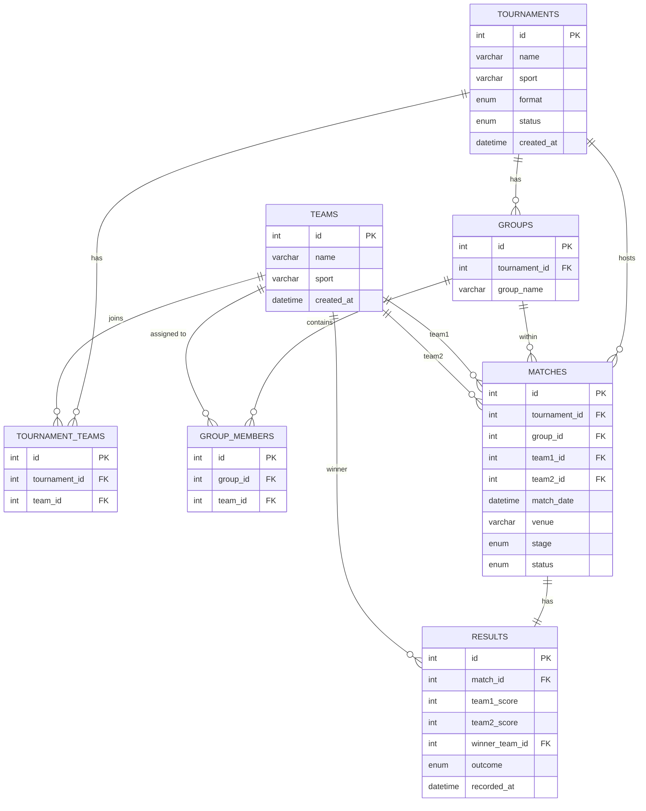

# Database Design — Sports Tournament Organizer

**Author:** Divyanshu  
**Last Updated:** 2026  
**Database:** MySQL  

---

## What is this file?

This document explains how I designed the database for our Sports Tournament Organizer project. It covers what tables I created, why I created them, what data goes inside each one, and how they are connected to each other.

Think of the database like a set of Excel sheets. Each sheet (table) stores one type of information, and they are linked together using IDs.

---

## ER Diagram

> The diagram below shows all 7 tables and how they are connected to each other.



---

## Table Descriptions

Here I explain each table in simple words, followed by the column details.

---

### 1. `tournaments`

**What it does:**  
This table stores every tournament that is created in the system. For example, if someone creates "Inter-College Cricket Cup 2024", it gets saved here with its sport type, format (knockout or round-robin), and current status.

| Column | Type | Description |
|--------|------|-------------|
| `id` | INT, PK, AUTO_INCREMENT | Unique ID given to each tournament automatically |
| `name` | VARCHAR(100) | Name of the tournament |
| `sport` | VARCHAR(50) | Type of sport — Cricket, Football, Basketball, etc. |
| `format` | ENUM('knockout', 'round_robin', 'both') | How the tournament is played |
| `status` | ENUM('upcoming', 'ongoing', 'completed') | Current state of the tournament |
| `created_at` | DATETIME | When the tournament was created |

---

### 2. `teams`

**What it does:**  
This table stores all the teams that register in the system. A team registers once and can then be added to multiple tournaments.

| Column | Type | Description |
|--------|------|-------------|
| `id` | INT, PK, AUTO_INCREMENT | Unique ID for each team |
| `name` | VARCHAR(100) | Team name — must be unique |
| `sport` | VARCHAR(50) | Sport the team plays |
| `created_at` | DATETIME | When the team registered |

---

### 3. `tournament_teams`

**What it does:**  
One team can participate in many tournaments, and one tournament can have many teams. This table acts as the bridge between them. It just stores which team joined which tournament.

| Column | Type | Description |
|--------|------|-------------|
| `id` | INT, PK, AUTO_INCREMENT | Unique row ID |
| `tournament_id` | INT, FK → tournaments.id | Which tournament |
| `team_id` | INT, FK → teams.id | Which team |

> **Example:** If Team A and Team B both join Tournament 1, this table will have two rows — one for each team.

---

### 4. `groups`

**What it does:**  
In a round-robin tournament, teams are divided into groups (Group A, Group B, etc.). This table stores those group names for each tournament.

| Column | Type | Description |
|--------|------|-------------|
| `id` | INT, PK, AUTO_INCREMENT | Unique group ID |
| `tournament_id` | INT, FK → tournaments.id | Which tournament this group belongs to |
| `group_name` | VARCHAR(50) | Name of the group e.g. "Group A", "Group B" |

---

### 5. `group_members`

**What it does:**  
After the DSU algorithm divides teams into groups, this table saves the result — which team goes into which group. One team is in one group, and one group has many teams.

| Column | Type | Description |
|--------|------|-------------|
| `id` | INT, PK, AUTO_INCREMENT | Unique row ID |
| `group_id` | INT, FK → groups.id | Which group |
| `team_id` | INT, FK → teams.id | Which team is in that group |

> **Note:** This table gets filled by the DSU module (Rahimul/Shemphang's part) through the `groups.php` API endpoint.

---

### 6. `matches`

**What it does:**  
This table stores every match scheduled in a tournament — who is playing against whom, on what date, at what venue, and at what stage (group stage, semifinal, final etc.).

| Column | Type | Description |
|--------|------|-------------|
| `id` | INT, PK, AUTO_INCREMENT | Unique match ID |
| `tournament_id` | INT, FK → tournaments.id | Which tournament this match belongs to |
| `group_id` | INT, FK → groups.id *(nullable)* | Which group — left empty for knockout matches |
| `team1_id` | INT, FK → teams.id | First team playing |
| `team2_id` | INT, FK → teams.id | Second team playing |
| `match_date` | DATETIME | Date and time of the match |
| `venue` | VARCHAR(100) | Location where the match is played |
| `stage` | ENUM('group', 'quarterfinal', 'semifinal', 'final') | Stage of the tournament |
| `status` | ENUM('scheduled', 'ongoing', 'completed') | Current match status |

> **Important:** `group_id` is nullable because knockout stage matches (semifinals, finals) do not belong to any group.

---

### 7. `results`

**What it does:**  
After a match is played, the score and winner are stored here. Every match has exactly one result entry.

| Column | Type | Description |
|--------|------|-------------|
| `id` | INT, PK, AUTO_INCREMENT | Unique result ID |
| `match_id` | INT, FK → matches.id | Which match this result belongs to |
| `team1_score` | INT | Score of team 1 |
| `team2_score` | INT | Score of team 2 |
| `winner_team_id` | INT, FK → teams.id *(nullable)* | The team that won — null if it's a draw |
| `outcome` | ENUM('team1_win', 'team2_win', 'draw') | Result of the match |
| `recorded_at` | DATETIME | When the result was entered |

> **Note:** `winner_team_id` is kept nullable to handle draws.

---

## How the Tables Connect (Relationships)

| Relationship | Type | Simple Explanation |
|---|---|---|
| Tournament → Teams | Many-to-Many via `tournament_teams` | Many teams can join many tournaments |
| Tournament → Groups | One-to-Many | One tournament has multiple groups |
| Group → Teams | Many-to-Many via `group_members` | Many teams in many groups |
| Tournament → Matches | One-to-Many | One tournament has many matches |
| Group → Matches | One-to-Many | One group has multiple matches (nullable) |
| Match → Result | One-to-One | Each match has exactly one result |

---

## Flow of Data (How everything works together)

```
1. Admin creates a Tournament
        ↓
2. Teams register and join the Tournament  (tournament_teams)
        ↓
3. DSU algorithm divides teams into Groups  (groups + group_members)
        ↓
4. Matches are generated for each group  (matches)
        ↓
5. Scores are entered after each match  (results)
        ↓
6. Winner is determined from results
```

---

## Important Notes

- A team **must** be added to `tournament_teams` before it can be assigned to a group or a match.
- `group_id` in `matches` is **left empty (NULL)** for knockout rounds — only group stage matches have a group.
- `winner_team_id` in `results` is **left empty (NULL)** when the match ends in a draw.
- The DSU module will communicate with my `groups.php` endpoint to save group assignments.
- All PHP endpoints return JSON so the frontend can read them easily.
- Database passwords will **not** be pushed to GitHub — they will be stored in a separate `config.php` file.
